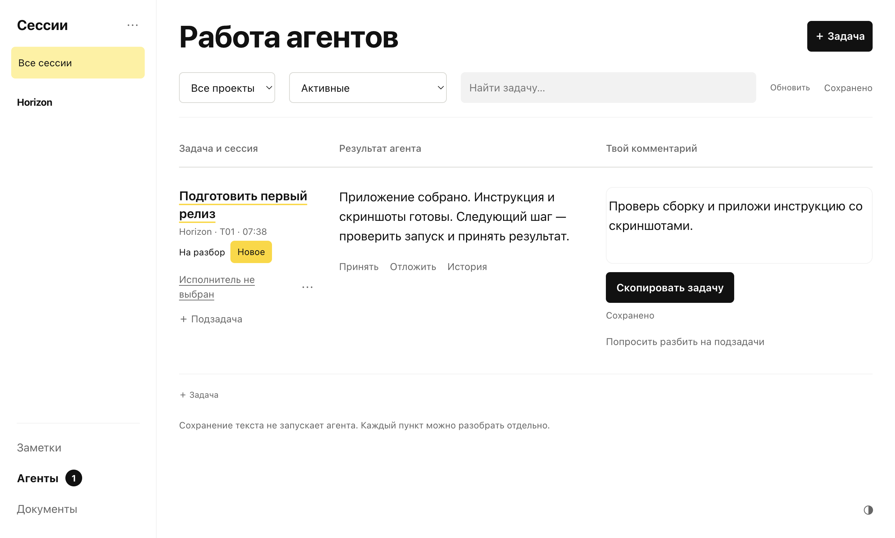

# Horizon

Локальное рабочее пространство для документов Markdown, заметок и работы с агентами. Приложение для macOS на Electron. Файлы остаются на твоём Mac.



Идея и первый визуальный ориентир — [Verticals](https://github.com/konstantinopolskii/verticals). Horizon начался с реверс-инжиниринга их скриншота с помощью ИИ, пока Verticals ещё были в разработке. [История приложения](docs/story.md).

[Инструкция](docs/getting-started.md) · [Агенты](docs/agents.md) · [Приватность](docs/privacy.md) · [Сообщить об ошибке](https://github.com/gletushov/horizon/issues/new?template=bug_report.yml)

## Установка на Mac

Требуется macOS 13 Ventura или новее.

1. Скачай сборку со страницы [Releases](https://github.com/gletushov/horizon/releases): `arm64` для Apple Silicon, `x64` для Intel.
2. Открой `.dmg` и перетащи **Horizon** в **Applications / Программы**.
3. Запусти Horizon по иконке. Terminal и отдельный Node.js для приложения не нужны.

Первая версия подписана локальной ad-hoc подписью, без Apple Developer ID и notarization. macOS может заблокировать скачанную сборку. Для доверенной сборки используй системное **Настройки → Конфиденциальность и безопасность → Всё равно открыть**. См. [инструкцию Apple](https://support.apple.com/102445).

## Данные

При первом запуске создаётся пустая рабочая папка в `~/Library/Application Support/Horizon/workspace`. Через **Файл → Открыть рабочую папку…** можно выбрать существующую папку Horizon. Файлы не копируются и не перемещаются. Это также способ продолжить работу с прежней браузерной версией.

Рабочие документы, заметки, таблица агентов, история и настройки подключённых проектов хранятся в выбранной папке. Черновики и предпочтения интерфейса — в профиле приложения на этом Mac. Для каждой рабочей папки сохраняются отдельный профиль и локальный порт. Если сохранённый порт занят, приложение сообщит об этом.

Закрытие окна скрывает Horizon; **⌘Q** завершает приложение и его локальный сервер. Существующие браузерные черновики не переносятся: перед переходом сохрани их в файлы. Приложение не заменяет резервную копию документов.

Новые заметки сохраняются в `notes/continuous-note.md`. Старые рабочие папки читаются без переноса файлов. Подробности хранения — в [инструкции](docs/getting-started.md#рабочая-папка).

## Что умеет

- Читать и редактировать Markdown, открывать документы во вкладках, вставлять изображения.
- Сохранять заметки и превращать их в документы или задачи.
- Обсуждать задачи и подзадачи с агентами, назначать сессии и принимать результаты.
- Подключать локальные проекты без переноса их файлов.

Для заметок и документов Codex не нужен. Интеграция с агентами требует отдельно установленного Codex CLI и авторизации. CLI ищется в пользовательской папке, PATH, Homebrew и Codex.app; другой путь задаётся переменной `HORIZON_CODEX_BIN`. Поддержка очереди зависит от версии Codex; статус Queued подтверждает постановку в очередь, а не выполнение. Для других провайдеров доступно копирование поручения. Приложение не содержит API-ключей и не отправляет поручения без действия пользователя.

## Разработка и сборка

```sh
git clone https://github.com/gletushov/horizon.git
cd horizon
npm ci
npm test
npm run desktop
```

Нужны Node.js 22.12+ и npm. Собрать `.app` без установщика на текущую архитектуру:

```sh
npm run pack:mac
```

Собрать `.dmg` и `.zip` для Apple Silicon и Intel на Mac:

```sh
npm run build:mac
```

Результат — в `dist/`. CI также собирает обе архитектуры и сохраняет установщики как artifacts. Сборки без Developer ID не проходят Apple notarization. Автообновления пока не подключены.

Проверка собранного приложения настоящим Electron через Playwright:

```sh
npm run test:desktop -- dist/mac-arm64/Horizon.app/Contents/MacOS/Horizon
```

Для Intel путь — `dist/mac/Horizon.app/Contents/MacOS/Horizon`.

Браузерный режим сохранён: `npm start`, затем `http://127.0.0.1:4317`. В чистой копии сначала запусти `npm run desktop`, затем используй созданную рабочую папку:

```sh
HORIZON_ROOT="$HOME/Library/Application Support/Horizon/workspace" npm start
```

## Открытый код

[MIT](LICENSE). Зависимости и шрифт сохраняют свои лицензии: [THIRD_PARTY_NOTICES.md](THIRD_PARTY_NOTICES.md). Правила участия — [CONTRIBUTING.md](CONTRIBUTING.md).

Публичный репозиторий содержит код и тесты. Личные документы, локальная конфигурация подключённых проектов и прежняя частная Git-история исключены. Проверка пакетов и ограничения — в [отчёте о приватности](docs/privacy.md).
