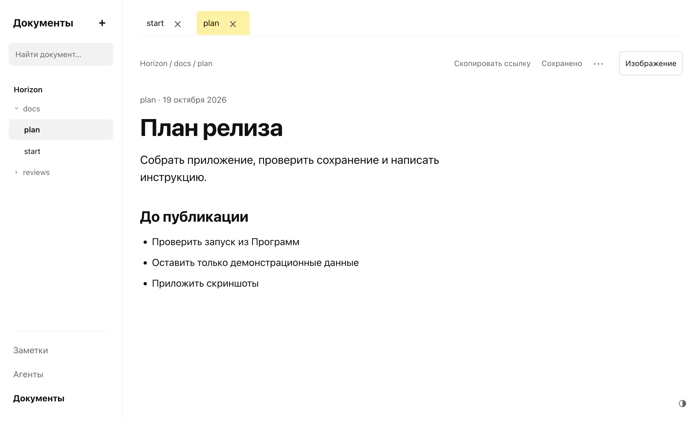

# Начать работу с Horizon

Horizon хранит заметки, документы и обсуждения задач в локальных файлах. Для работы с ними агент и подписка на ИИ не нужны.

## Установка

1. Скачай [последний релиз](https://github.com/gletushov/horizon/releases/latest): arm64 для Apple Silicon, x64 для Intel. Нужна macOS 13 или новее.
2. Открой DMG и перетащи Horizon в Программы. Запусти по иконке.
3. Если macOS заблокировала скачанную сборку, используй системное «Конфиденциальность и безопасность → Всё равно открыть». [Инструкция Apple](https://support.apple.com/102445). Developer ID и Apple notarization пока не подключены.

Приложение включает свой Node.js. Terminal для его запуска не нужен. Закрытие окна оставляет Horizon работающим; ⌘Q завершает его.

## Рабочая папка

Первый запуск создаёт пустую папку `~/Library/Application Support/Horizon/workspace`. В меню **Файл → Открыть рабочую папку…** можно выбрать свою, например папку в Documents. Horizon перезапустится и будет работать с ней. Документы не копируются и не перемещаются.

В рабочей папке находятся:

| Что | Где |
|---|---|
| Заметки | `notes/continuous-note.md` |
| Быстрые записи | `notes/inbox.md` |
| Таблица задач и комментариев | `reviews/agent-overview.md` |
| Добавленные изображения | `assets/horizon-images/` |
| История и удалённые файлы | `.history/`, `.trash/` |
| Подключения проектов | `horizon.config.json` |
| Сессии, состояние и локальный порт | `.horizon/`, `.runtime/` |

Черновики полей и настройки интерфейса хранятся в профиле приложения на этом Mac, отдельно от рабочей папки. Перед переносом на другой Mac сохрани черновики в файлы. Копия рабочей папки сохраняет документы, изображения и историю, но не эти черновики.

Документы подключённых проектов остаются в папках самих проектов. Центральная рабочая папка не содержит их копий. В старых рабочих папках Horizon продолжает читать прежний каталог личных записей; автоматической миграции нет.

## Заметки, документы и задачи

- **Заметки:** напиши мысль и нажми «Добавить» или ⌘Enter. У записи есть дата; через ⋯ её можно превратить в документ или задачу.
- **Документы:** открой файл в дереве и редактируй. Дождись «Сохранено»; ⌘S запускает сохранение сразу. Вкладки сохраняют место в тексте.
- **Агенты:** создай задачу, напиши поручение и выбери исполнителя через ⋯. Сохранение комментария само по себе не запускает агента. [Подключение агентов](agents.md).

## Если что-то сломалось

В меню **Справка → Сообщить об ошибке** откроется [форма GitHub Issue](https://github.com/gletushov/horizon/issues/new?template=bug_report.yml). Нужен аккаунт GitHub. Укажи версию, macOS, шаги, ожидаемый и фактический результат. Можно добавить скриншот с демонстрационными данными. Обсуждение продолжается в комментариях этого Issue.

Horizon не прикладывает заметки, пути, переписку с агентом или логи автоматически. Перед отправкой проверь свои вложения. Рабочую папку целиком отправлять не нужно.
