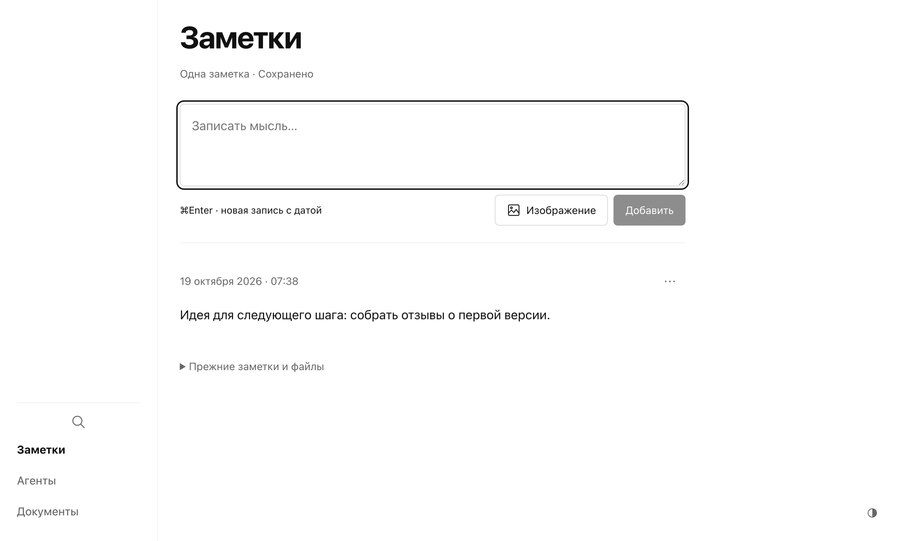

# Horizon: из скриншота в приложение для Mac

Мне хотелось держать заметки, рабочие документы и обсуждения с агентами в одном месте. Чтобы результат работы не терялся в чате: открыл задачу, прочитал ответ, оставил замечание и принял конкретную версию.

Меня вдохновили [Verticals](https://github.com/konstantinopolskii/verticals). Когда они ещё были в разработке, я увидел скриншот и начал собирать своё приложение с помощью ИИ: через реверс-инжиниринг интерфейса по этому скриншоту. Так появился Horizon. Verticals — источник идеи и начальный визуальный ориентир; этот вклад я хочу обозначить прямо.

Дальше Horizon стал складываться вокруг моей работы с файлами и агентами. В основе остались обычные Markdown-документы. Их можно открыть другим редактором, хранить в Git или скопировать в другую папку. Приложение показывает их как документы, заметки и задачи с отдельным местом для ответа агента и моего комментария.

На экране задачи видно поручение, результат и следующий шаг. Подзадачу можно обсуждать отдельно. Сохранение текста не запускает агента: я сам передаю поручение и решаю, когда результат принят.

Для быстрых мыслей есть заметки. Запись можно оставить как есть, превратить в документ или сделать из неё задачу.

Документы открываются во вкладках. Текст редактируется на месте; Markdown остаётся форматом хранения. Изображения лежат рядом с рабочими файлами.

Теперь Horizon запускается как обычное приложение из «Программ». В нём свой Node.js, поэтому для запуска не нужно держать Terminal открытым. Рабочую папку можно выбрать самому. Заметки и история остаются локальными; черновики интерфейса сохраняются в профиле приложения на этом Mac.

Я открыл исходный код под MIT. Хочется, чтобы другие могли посмотреть, собрать свою версию, сообщить о проблеме и предложить улучшение. В [PR №65 Verticals](https://github.com/konstantinopolskii/verticals/pull/65) подсмотрел ещё один полезный подход: одна задача в PR, объяснение результата, выполненные проверки и скриншоты на демонстрационных данных. В Horizon эти правила описаны в [CONTRIBUTING.md](../CONTRIBUTING.md).

Это ранняя версия. Универсальный способ работы с агентом — скопировать поручение в свой инструмент. Автоматическая отправка в Codex экспериментальная, другие провайдеры работают через копирование. Установщики пока без Apple notarization, автообновления не подключены. Все скриншоты здесь сделаны на вымышленном проекте, без личных заметок.

[Скачать для Mac](https://github.com/gletushov/horizon/releases/latest) · [Начать работу](getting-started.md) · [Подключить агента](agents.md) · [Сообщить об ошибке](https://github.com/gletushov/horizon/issues/new?template=bug_report.yml)
